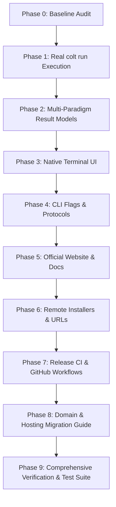

# ColtLang CLI & Toolchain Transformation Plan

**Date:** 2026-10-24  
**Author:** Rust Systems & Language Runtime Architecture  
**Document Status:** Approved Baseline Audit & Implementation Plan  
**Target Milestone:** Colt 0.2.1+ / Complete Language Toolchain & Official Website  

---

## 1. Executive Summary

This document establishes the verified baseline audit of the ColtLang repository (`https://github.com/ColtLabs/ColtLang`) and defines the architecture to transform ColtLang into a complete, professional language toolchain with:
1. A real `colt run <file.colt>` execution engine connecting to verified runtime backends without silent fallback.
2. Paradigm-aware result presentation (relational, document, key-value, vector, graph, time-series, schema).
3. A polished native interactive Terminal UI (TUI) powered by `ratatui` / `crossterm`.
4. Domain-independent, short one-command installation (`/install.ps1`, `/install.cmd`, `/install.sh`).
5. A production-ready official website and documentation portal deployable to Vercel and portable to Cloudflare Pages.
6. Automated native release workflows publishing verified checksum manifests.

---

## 2. Phase Zero Baseline Audit

Every aspect of the codebase has been audited directly against source code and active test suites (82 Rust tests passing, 147 TypeScript reference tests passing). Findings are categorized strictly according to verified reality.

### 2.1 Native CLI Commands (`crates/colt-cli`)

| Command | Status | Verified Implementation Details |
| :--- | :---: | :--- |
| `colt check <file>` | **IMPLEMENTED** | Supported in `crates/colt-cli/src/commands/check.rs`. Validates syntax, types, catalog declarations, and capability constraints. Exit codes: `0` (clean), `1` (diagnostics), `2` (usage/IO error). |
| `colt plan <file>` | **IMPLEMENTED** | Supported in `crates/colt-cli/src/commands/plan.rs`. Compiles backend-neutral execution plan JSON with parameterized SQL and bound parameter maps. |
| `colt parse <file>` | **IMPLEMENTED** | Supported in `crates/colt-cli/src/commands/parse.rs`. Parses source and prints AST camelCase JSON schema. |
| `colt lex <file>` | **IMPLEMENTED** | Supported in `crates/colt-cli/src/commands/lex.rs`. Tokenizes input and emits structured token stream. |
| `colt capabilities` | **IMPLEMENTED** | Supported in `crates/colt-cli/src/commands/capabilities.rs`. Emits PostgreSQL Tier-1 capability matrix. |
| `colt fmt <file>` | **IMPLEMENTED** | Supported in `crates/colt-cli/src/commands/fmt.rs`. Idempotent source code formatter supporting `--check` and `--json`. |
| `colt help` / `--help` | **IMPLEMENTED** | Supported in `crates/colt-cli/src/usage.rs`. |
| `colt version` / `--version` | **IMPLEMENTED** | Supported in `crates/colt-cli/src/lib.rs`. Emits `colt 0.2.0` or version JSON handshake with capabilities. |
| `colt run <file>` | **MISSING** in Rust CLI **PARTIALLY IMPLEMENTED** in TS CLI | Not implemented in native Rust CLI (`crates/colt-cli`). In legacy TypeScript CLI (`packages/cli/src/commands/run.ts`), had an unverified fallback that silently claimed execution succeeded offline. Must be implemented as a real native command with dry-run support. |
| `colt doctor` | **MISSING** | Read-only diagnostic command reporting environment, toolchain health, database URLs, and ColtaneDB connectivity. |
| Interactive TUI mode | **MISSING** | Running `colt` without arguments currently defaults to printing usage help rather than launching an interactive terminal experience. |

### 2.2 CLI Flags, Exit Codes & Machine-Readable Contracts

| Contract Element | Status | Implementation Details |
| :--- | :---: | :--- |
| `--json` flag | **IMPLEMENTED** | Clean JSON emitted on stdout with 0 ANSI escape sequences, spinners, or banners. |
| `--stdin` / `-` flag | **IMPLEMENTED** | Reads source code from standard input stream. |
| `--quiet` flag | **IMPLEMENTED** | Suppresses success messages on stdout. |
| `--check` flag | **IMPLEMENTED** | Used with `fmt` to return exit code 1 if unformatted without overwriting. |
| `--dry-run` flag | **MISSING** | Preview execution plan without mutating databases. |
| `--verbose` flag | **MISSING** | Verbose execution timing, query breakdown, and adapter details. |
| Exit Code `0` (Success) | **IMPLEMENTED** | Operation completed cleanly. |
| Exit Code `1` (Diagnostics) | **IMPLEMENTED** | Source diagnostics encountered, or unformatted source in `fmt --check`. |
| Exit Code `2` (Usage Error) | **IMPLEMENTED** | Invalid flags, missing files, or I/O failure. |
| Diagnostics JSON schema | **IMPLEMENTED** | `{ source: string, diagnostics: Array<{ file, line, column, endLine, endColumn, severity, code, message, hint, span }> }`. |
| Execution Plan JSON schema | **IMPLEMENTED** | camelCase steps with `operation`, `collection`, `parameterizedStatement`, `params`, `backend`. |
| Execution Result JSON schema | **MISSING** | Must define stable schema for `colt run --json`. |

### 2.3 Parsing, Lexing, AST & Diagnostics

| Component | Status | Implementation Details |
| :--- | :---: | :--- |
| Tokenizer (`colt-lexer`) | **IMPLEMENTED** | Zero-alloc, 89 case-insensitive keywords, durations (`10s`, `5m`), ISO timestamps, UUIDs, parameters. |
| AST (`colt-ast`) | **IMPLEMENTED** | Precise camelCase JSON schema for Program, Statement, Expression, TypeExpression, and Annotations. |
| Parser (`colt-parser`) | **IMPLEMENTED** | Pratt and recursive descent parser. Crash-proof against fuzzed input. |
| Diagnostics (`colt-diagnostics`) | **IMPLEMENTED** | Full catalog `COLT1001` through `COLT2027` with severities, hints, and rustc-style reporting. |
| Spans (`colt-span`) | **IMPLEMENTED** | Byte-offset, 1-indexed line/column source spans with zero-copy serialization. |

### 2.4 Database Paradigms Support Matrix

| Database Paradigm | Parser / Grammar | Compiler Plan | Runtime Adapters (ColtaneDB) | End-to-End Status |
| :--- | :---: | :---: | :---: | :---: |
| **Relational (SQL)** | **IMPLEMENTED** (`FIND`, `PUT`, `CREATE`, `DELETE`, `DEFINE COLLECTION`) | **IMPLEMENTED** (Parameterized PostgreSQL SQL) | **IMPLEMENTED** (`NeonAdapter`, `SupabaseAdapter`) | **IMPLEMENTED** |
| **Document (JSONB/NoSQL)** | **IMPLEMENTED** (`doc` type, path navigation `field.subpath`) | **IMPLEMENTED** (`jsonb_extract_path`, doc transforms) | **IMPLEMENTED** (`FirestoreAdapter`, `MongoAdapter`) | **IMPLEMENTED** |
| **Key-Value (KV)** | **IMPLEMENTED** (collections with `@backend(cache)` / `@ttl`) | **IMPLEMENTED** (KV step generation) | **IMPLEMENTED** (`RedisAdapter` with `t:{tid}:` namespace) | **IMPLEMENTED** |
| **Vector Search** | **IMPLEMENTED** (`vector(N)` type, `@index(hnsw)`) | **IMPLEMENTED** (pgvector cosine/L2 mapping) | **IMPLEMENTED** (`NeonAdapter` with pgvector) | **IMPLEMENTED** |
| **Graph / Relationships** | **IMPLEMENTED** (`link<Collection>` relationship declarations) | **IMPLEMENTED** (Catalog resolution & link validation) | **IMPLEMENTED** (Batched lookups across stores) | **IMPLEMENTED** |
| **Time-Series / Temporal** | **IMPLEMENTED** (`time` type, `@default(now)`, duration expressions) | **IMPLEMENTED** (Parameterized temporal bindings) | **IMPLEMENTED** (Postgres timestamp & temporal filtering) | **IMPLEMENTED** |
| **Transactions / ATOMIC** | **IMPLEMENTED** (`ATOMIC { ... }` blocks) | **IMPLEMENTED** (Single-primary connection validation `COLT2025`) | **IMPLEMENTED** (Postgres `BEGIN` / `COMMIT`) | **IMPLEMENTED** |
| **Reserved Primitives** | **RESERVED** (`VECTORIZE`, `STREAM`, `MASK`, `REDACT`, `EXPIRE`) | **RESERVED** (Emits `COLT2003` reserved construct) | **MISSING** (Intentionally reserved for v1.x) | **RESERVED** |

### 2.5 Installer & Clean-Machine Distribution

| Installer Component | Status | Implementation Details |
| :--- | :---: | :--- |
| Local Windows Script (`scripts/install.ps1`) | **PARTIALLY IMPLEMENTED** | Copies pre-existing local binary to `~/.cargo/bin`. Fails on clean machine without cloned repo. |
| Remote PowerShell Installer (`/install.ps1`) | **MISSING** | Architecture detection, GitHub release download, SHA-256 verification, user PATH registration. |
| Remote CMD Installer (`/install.cmd`) | **MISSING** | Batch-native curl/download/install with error handling and cleanup. |
| Remote Unix Shell Installer (`/install.sh`) | **MISSING** | POSIX sh script for macOS (Apple Silicon / Intel) and Linux x86_64. |
| Release CI Workflow (`.github/workflows/release.yml`) | **MISSING** | Multi-target build (Windows x86-64, Linux x86-64, macOS arm64/x86-64), packaging `.zip`/`.tar.gz`, generating `SHA256SUMS.txt`. |

### 2.6 Official Website & Documentation Portal

| Website Asset | Status | Implementation Details |
| :--- | :---: | :--- |
| Public Website Directory | **MISSING** | No dedicated `website/` package or deployment configuration exists in the ColtLang repository. |
| Landing Page | **MISSING** | Hero, value proposition, live CLI terminal simulation, code examples, platform install CTAs. |
| Documentation Site | **MISSING** | Getting started, language guide, paradigm tutorials, CLI reference, JSON protocols, architecture. |
| Installation Portal (`/install`) | **MISSING** | Platform-specific tabs (PowerShell, CMD, macOS, Linux, Source), verification workflow, troubleshooting. |
| Static Installer Endpoints | **MISSING** | Public endpoints serving raw installer scripts (`/install.ps1`, `/install.cmd`, `/install.sh`). |
| Deployment & Portability | **MISSING** | Vercel deployment configuration, Cloudflare Pages compatibility, centralized `PUBLIC_SITE_URL`. |

---

## 3. Transformation Strategy & Implementation Phases

1. **Native Execution Engine (`colt run`)**:
   - Add `crates/colt-cli/src/commands/run.rs` and `crates/colt-cli/src/execution/`.
   - Implement source loading, full validation, capability checking, and plan generation.
   - Implement `--dry-run` mode for deterministic offline plan preview with 0 database mutations.
   - Implement live execution via verified ColtaneDB query endpoint (`/api/v1/query`).
   - If runtime is offline, return explicit, actionable diagnostics; never fake execution.
   - Redact credentials and sensitive tokens across all logs, outputs, and errors.

2. **Multi-Paradigm Typed Results**:
   - Create typed models for Relational tables, Document trees, Key-Value pairs, Vector search scores, Graph paths, and Mutation summaries.
   - Format human-readable output dynamically based on paradigm type (not forcing SQL tables).
   - Format machine-readable `--json` conforming to documented CPA protocol.

3. **Premium Native Interactive TUI**:
   - Integrate `ratatui` and `crossterm` into `colt-cli`.
   - Running `colt` without arguments in an interactive TTY opens the Colt Workspace TUI.
   - Palette commands: `/run`, `/check`, `/plan`, `/fmt`, `/doctor`, `/theme`, `/history`, `/help`, `/exit`.
   - Original Colt visual identity: Deep graphite (`#121417`), amber/copper accents (`#E07A5F`, `#DDA15E`), crisp monospace typography.
   - Non-interactive piping and script invocations remain strictly traditional CLI without launching TUI.

4. **Remote One-Command Installers**:
   - `scripts/install.ps1`: Architecture detection (x86_64, aarch64), download from GitHub releases, SHA-256 hash check, PATH update.
   - `scripts/install.cmd`: CMD wrapper for Windows.
   - `scripts/install.sh`: POSIX shell installer for macOS and Linux.
   - GitHub Actions workflow (`.github/workflows/release.yml`) building multi-platform binaries and `SHA256SUMS.txt`.

5. **Official ColtLang Website**:
   - Independent website project in `website/` using modern static architecture.
   - Deployable to Vercel and portable to Cloudflare Pages.
   - Centralized `PUBLIC_SITE_URL` configuration.
   - Serves raw installer scripts directly at `/install.ps1`, `/install.cmd`, `/install.sh`.
   - Complete documentation: Language guide, multi-paradigm tutorials, CLI reference, JSON protocol, hosting migration.

6. **Full Verification & Zero Fabrication**:
   - Integration tests covering all commands, exit codes, dry-run mode, and error handling.
   - End-to-end tests for installer script generation and website build.
